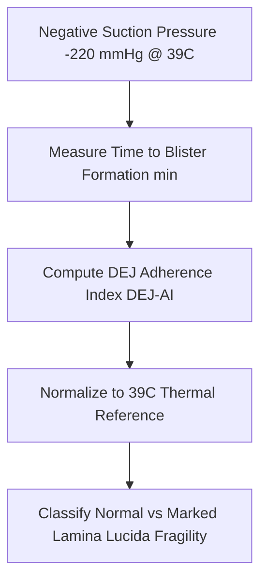

# Cutaneous Suction Blister DEJ Adhesion Personal Agent Skill

[](LICENSE)
[](https://www.python.org/)
[]()
[]()
[]()

Deterministic, zero-mock personal agent micro-skill for calculating Suction Blister Formation Time (SBFT in minutes) and Dermo-Epidermal Junction Adherence Index (DEJ-AI) to evaluate basement membrane zone mechanical resilience.

## Architecture



## Quickstart

```python
from client import SuctionBlisterDEJClient

client = SuctionBlisterDEJClient()
result = client.evaluate_sbft(
    blister_formation_time_min=65.0,
    suction_pressure_mmhg=-220.0,
    skin_surface_temp_c=39.0
)
print(result)
```

## License

Apache-2.0
